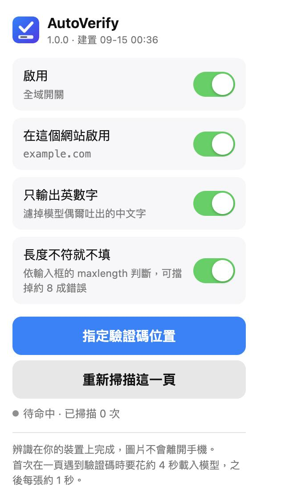

# AutoVerify for iOS Safari

本機端驗證碼辨識與自動填寫的 Safari 擴充功能。模型與推論全部在裝置上完成，圖片不會離開手機。



<sub>擴充的設定面板。辨識與填入在背景自動進行，平常不需要打開它。</sub>

---

## 這是什麼

把 Chrome 版 AutoVerify 的想法重寫成 iOS Safari Web Extension：

- **辨識模型**：ddddocr 的 CRNN + CTC（126 層 Conv + 2 層 LSTM，int8 動態量化，8210 類 charset）
- **推論引擎**：ONNX Runtime Web 1.14.0，WASM SIMD backend
- **執行位置**：**content script（分頁環境）**，不是 background service worker

### 為什麼推論放在 content script

iOS 上擴充功能的 background process 有約 80 MB 記憶體上限，而 ORT runtime（10 MB）+ 模型（13.6 MB）+ 推論時的 heap 很貼近這個天花板。分頁環境的預算寬鬆得多，而且已經在實機上實測通過。代價是每頁要重新建立一次 session（約 4 秒），所以程式碼只在**偵測到頁面上真的有驗證碼時**才載入模型。

---

## ⚠️ 不要升級 ONNX Runtime

本專案鎖定 **onnxruntime-web 1.14.0**，這是刻意的。

`onnxruntime-web` 從 **1.19 起官方只提供「執行緒版」wasm**（`ort-wasm-simd-threaded.wasm`），
它匯入的是 **shared memory**——必須由 SharedArrayBuffer 支撐，且因為 grow 時不能搬移，
必須在初始化時一次預留完整的 `maximum`（4 GB）位址空間。**iOS Safari 給不出來**，
一律失敗於：

```
no available backend found. ERR: [wasm] RangeError: Out of memory
```

設 `numThreads = 1` 救不了——那是 wasm 二進位檔本身的記憶體宣告，不是執行期設定。

**不必上機就能驗證**：解析 wasm 的 memory section，看 shared flag。
1.14 / 1.18 的 `ort-wasm-simd.wasm` 是 `shared=false`（非共享，可懶惰成長），
1.22 / 1.29 的執行緒版是 `shared=true`。**1.18 是最後一個仍提供非執行緒版的版本。**

升級也沒有速度好處：同一工作階段內暖機後實測，1.14 / 1.18 / 1.22 的
session 建立都約 150 ms、每張推論都是 28 ms，三者無差異。


## 建置與安裝（免付費開發者帳號）

需要：Mac + Xcode + iPhone + 一條傳輸線。

- **免費 Apple ID**：可以簽，但 provisioning profile **只有 7 天**，到期要重新建置安裝。
  而且 `xcodebuild` 無法自行向 Apple 申請 profile（它讀不到 Xcode 的帳號 session），
  過期後必須開 Xcode GUI 建置一次才會重新產生。
- **付費 Apple Developer Program**（US$99/年）：profile 與憑證效期都是**一年**，
  而且付費帳號**必須先在帳號中註冊裝置**才能簽（免費團隊會自動加）。

1. 開啟專案

   ```
   open build/AutoVerify/AutoVerify.xcodeproj
   ```

2. **設定簽名**
   - 左側點 `AutoVerify` 專案 → TARGETS 選 `AutoVerify`
   - `Signing & Capabilities` 分頁 → 勾選 `Automatically manage signing`
   - `Team` 下拉選單 → `Add an Account…` → 登入你的 Apple ID → 選擇 `(Personal Team)`
   - **對 `AutoVerify Extension` target 重複同樣動作**（兩個 target 都要）

3. **如果 Bundle ID 衝突**（顯示紅字 "already in use"），把兩個 target 的 ID 都換掉，注意擴充必須是 App 的子項：
   - App：`com.你的名字.AutoVerify`
   - Extension：`com.你的名字.AutoVerify.Extension`

4. iPhone 接上電腦，Xcode 左上角裝置選單選你的手機，按 ⌘R

5. 第一次會失敗並提示「不受信任的開發者」。到手機上：
   **設定 → 一般 → VPN 與裝置管理 → 你的 Apple ID → 信任**
   然後回 Xcode 再按一次 ⌘R

6. **啟用擴充**：
   設定 → App → Safari → 延伸功能 → AutoVerify → 開啟「允許延伸功能」

7. **授權網站**：
   在 Safari 開啟目標網站 → 網址列左邊的「ぁA」按鈕 → 管理延伸功能 →
   AutoVerify → 選「允許」或「總是允許」

---

## 使用

開啟含驗證碼的網頁後，擴充會自動：

1. 掃描頁面找驗證碼圖片與對應輸入框（關鍵詞 + 尺寸啟發式，支援中英日韓俄等多語言關鍵詞）
2. 找到後才開始載入模型（右下角顯示「載入辨識模型…」，約 4 秒）
3. 辨識並填入（約 1 秒），右下角顯示「已填入 xxxx」
4. 按「換一張」時自動重新辨識

點工具列的擴充圖示可開啟設定：全域開關、單一網站開關、只輸出英數字、手動重新掃描。

---

## 已驗證 / 未驗證

**已在真實 iPhone（iOS 18.7 / Safari 27）量測：**

| 項目 | 數值 |
|---|---|
| 字元正確率 | 98.9%（Mac 對照組 98.3%） |
| 全對率 | 95.0%（Mac 對照組 92.7%） |
| WASM SIMD | 支援，8 次同輸入輸出完全一致 |
| ORT 載入 | 868 ms |
| Session 建立 | 3774 ms |
| 單張推論 | 約 990 ms |

**已驗證：** 專案編譯通過、27 MB 資源完整打包進 .appex、iOS Safari 正確解析 manifest 並註冊權限、擴充正常顯示在設定中。

**已在真機確認：** ORT 在 extension content-script 環境可正常載入推論。
（模擬器上無法開啟「允許延伸功能」開關——未簽名擴充的模擬器限制——所以這一步只能靠真機驗證。）

---

## 除錯

用 Mac 的 Safari 檢查 iPhone 上的頁面：

1. iPhone：設定 → App → Safari → 進階 → 開啟「網頁檢閱器」
2. Mac Safari：設定 → 進階 → 勾「顯示網頁開發者功能」
3. iPhone 接上 Mac，Mac Safari 選單列 → 開發 → 選你的 iPhone → 選頁面

Console 會看到 `[AutoVerify]` 開頭的訊息：

- `模型就緒 3774 ms` → 一切正常
- `session 建立失敗` → ORT 在 content script 環境載不起來，需要改走 Core ML + native messaging
- 什麼都沒有 → content script 沒注入，檢查網站授權（步驟 7）

---

## 調整

**偵測不到你的驗證碼**：編輯 `AutoVerify Extension/content.js`，
在 `IMG_KEYWORDS` / `INPUT_KEYWORDS` 加關鍵詞，或放寬 `isCaptchaImage()` 裡的尺寸範圍。

**辨識不準**：模型是 ddddocr 的通用模型，對特定網站的驗證碼可以用
[ddddocr](https://github.com/sml2h3/ddddocr) 自行訓練後替換 `model.bin` 與 `charset.js`
（輸入必須維持 `[1,1,64,W]` 灰階、正規化 `(x/255-0.5)/0.5`，輸出需內建 ArgMax）。

**想更快**：ORT 1.14.0 是 2023 年初的版本。換成 1.22 可能有明顯加速，
但那是未經實測的變數 —— 目前這組 1.14 + model.bin 是在你手機上量過 98.9% 的組合。

---

## 授權

模型來自 [ddddocr](https://github.com/sml2h3/ddddocr)（MIT）。
ONNX Runtime Web 為 MIT。本擴充程式碼可自由使用。

**注意**：與原版 Chrome 擴充不同，這裡**沒有**任何對外連線的回報功能。
原版 `inject.js` 內含一個把頁面所有 input/button/img 的 outerHTML 送到
`auto1verfiuy.freemyip.com/collect` 的函式，本專案未移植該功能。
